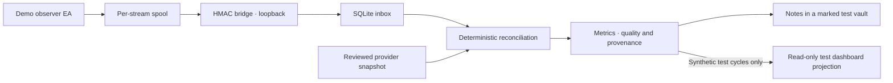

# Vidar MT5 Monitor

**VIDARNET** · *Deterministic systems. Observable intelligence. Verifiable workflows.*

Experimental MetaTrader 5 observability, deterministic reconciliation and auditable
trading infrastructure. This is VidarNet's first public research application:
source code, synthetic fixtures and reproducible checks—not a production trading
product.

**Version: `v0.1.0-dev` · Experimental research and development.**
There is no order executor in this distribution. Real-position management and
autonomous execution are **not validated**. The offline management simulator
always returns `execution_allowed=false` and `broker_result=NOT_SENT`.
**Do not use this release to operate real accounts.**

[Architecture](#system-architecture) · [Capabilities](#implemented-capabilities) ·
[Run the checks](#requirements-and-reproducible-tests) ·
[Documentation](#technical-documentation) · [Rights](#rights-attribution-and-reuse)

## System architecture

The observer stream provides triggers and an audit trail. A reviewed provider
snapshot supplies the separately checked account/history evidence used by the
reconciler. This diagram describes the experimental components; it is not a
claim of a commissioned live deployment.



Events do not replace broker history. A position that disappears without
verified closing evidence remains `UNKNOWN`. Metric quality is explicit:
`KNOWN`, `ESTIMATED`, `UNKNOWN` or `UNVERIFIABLE`. **Missing data is not zero.**
The dashboard projects engine results; it is not a second calculator or a live
trading interface. Observation and execution remain separate.

## Implemented capabilities

| Component | What is present in this version |
|---|---|
| Experimental observation | Demo MQL5 observer sources, per-stream spool handling and authenticated loopback ingestion. The C candidate checks the expected login/server and blocks on identity mismatch. |
| Deterministic reconciliation | Persistent supervisor, coverage-aware position state, confirmed-closure evidence, duplicate suppression and restart checks. |
| Risk metrics and provenance | Deterministic calculations with explicit quality, reason codes, algorithm versions and input digests. Unknown or insufficient coverage remains visible. |
| Test reporting | Automatic notes in a marked test vault, separate human journal templates and a read-only synthetic dashboard projection. |
| Offline inputs and service components | MCP normalizers, experimental filtered projection, HTML backfill, snapshot validation, outbox and backup logic. No account configuration or deployment units are distributed. |
| Offline management simulation | Synthetic break-even, partial-close and full-close scenarios with fail-closed checks. No executor and no broker requests. |
| Reproducible validation | Dedicated A/B, engine, supervisor, service, dashboard, C-host, shadow-management and HTML-backfill checks. |

The A and B families are deliberately separate and are **not interchangeable**.
B adds package imports, source/stream controls and integrated transactions.
MCP normalization is offline: it stores no keys and contacts no endpoint.
The optional RPyC client is experimental; see the security limitations below.

### Synthetic dashboard evidence

The [published validation record](evidence/publication/results.json) reports
**5 synthetic cycles, 82 metric rows and 10/10 dashboard checks**. The fixtures
are invented; these are not account results or commercial performance claims.

Explore the [synthetic dashboard harness](tests/run_dashboard_demo.py),
[read-only projection](src/engine/dashboard.py) and
[Markdown renderer](tools/render_test_dashboard.py). No screenshot of a live
account is included. The renderer is a manual projection, not an active service;
Profit/MaxDD and session statistics are not implemented in this feed.

## Development status and limitations

`v0.1.0-dev` is the initial experimental release. The
[immutable tag](https://github.com/h377ll/vidar-mt5-monitor/tree/v0.1.0-dev)
identifies the original reviewed code and validation baseline. Later presentation
changes do not turn it into a production version.

- Synthetic checks do not validate real account management, profitability,
  trading-firm rule compliance, delivery latency or autonomous execution.
- The C-host harness adapts function bodies to C++ and uses MT5 API doubles.
  It is **not a MetaEditor compilation**, terminal initialization or verification
  of an EX5 binary.
- Observer identity reads are not an atomic MT5 transaction. Queue loss,
  reinitialization and missing events require historical reconciliation. A
  `complete` flag does not prove atomicity or exhaustive coverage; the EA spool
  has no size limit.
- Test notes do not replace a definitive journal. Metrics do not establish full
  broker coverage or equivalence to a contractual drawdown definition.
- An uncertain outbox send is not automatically retried; remote exactly-once
  delivery is not guaranteed. Real notification delivery is not validated.
- No continuous deployment, live-provider compatibility or human-supervised
  autonomous trading system is validated by this release.

## Requirements and reproducible tests

Use Linux, **Python 3.10+** with its standard library (`sqlite3`, `fcntl`), a
**C++17-compatible `g++`** for C-host checks, and available ephemeral loopback
sockets. The published baseline was verified with Python **3.13.5**.
No `pip` installation, MT5, Wine, RPyC, credentials or Internet connection is
needed to run the checks after obtaining the repository.

To reproduce the original published baseline:

```bash
git clone https://github.com/h377ll/vidar-mt5-monitor.git
cd vidar-mt5-monitor
git checkout v0.1.0-dev
mt5_test_results="$(mktemp -d /tmp/vidar-mt5-public-tests-XXXXXX)"
env -i PATH=/usr/bin:/bin LANG=C.UTF-8 python3 -B tools/run_public_checks.py --output-dir "$mt5_test_results/run"
sha256sum -c SHA256SUMS
```

The output directory must be new and outside the repository. The runner creates
`summary.json`, logs and synthetic results there. It runs the supported harnesses
and HTML-backfill tests; **do not substitute `unittest discover`**, because the A
tests require their runner's injected fixtures.

The [baseline validation](docs/VALIDATION.md) records **321 tests and scenarios**,
plus dashboard and end-to-end checks, with no failures, errors or skips.
This is a statement about the published synthetic baseline, not live validation.

The development checkout does not install services. To inspect the CLI without
connecting to a provider:

```bash
python3 -B src/service/cli.py --help
```

Live integration would require a separately isolated demo, verified identity and
coverage, a reviewed provider, MQL5 compilation and protection checks. **Do not
run service commands with real configurations based on this README.**

## Security and data handling

Publication excludes credentials, tokens, account configurations, operational
SQLite databases, spools, logs, private history and deployment installations.
Tests use invented fixtures. A fixture's `real` label exercises a schema or
rejection path; it does not identify an observed real account.

The optional classic RPyC server can execute remote code. **Loopback alone does
not isolate it**: it requires a separate network namespace and privilege review.
It is not distributed or deployed here. Python test guards are not an
operating-system sandbox, and passing them does not prove absolute isolation.

Read [SECURITY.md](SECURITY.md) before making changes or reporting an issue.
Never post credentials, account identifiers, private history or operational
payloads in public issues; reproduce problems with invented data. A `.gitignore`
or secret scanner is not a complete privacy audit.

## Technical documentation

The [documentation index](docs/README.md) provides reading paths. Existing
technical, provenance and security records are preserved in their original
Spanish so the original evidence and caveats remain traceable.

| Reference | Purpose |
|---|---|
| [Validation](docs/VALIDATION.md) | Baseline environment, check counts and what the tests do not establish |
| [Provenance](docs/PROVENANCE.md) | Selected public sources, transformations, exclusions and rights |
| [Per-file provenance](docs/provenance/source-files.json) | Source and public hashes for the original selected code |
| [Demo observers](docs/phase-c/OBSERVERS.md) | Observer generations, identity gates and C-host limitations |
| [Security](SECURITY.md) | Publication checks, isolation limits and safe issue reporting |
| [Third-party dependencies](THIRD_PARTY.md) | External tools, attribution and reuse boundaries |
| [Changelog](CHANGELOG.md) | Experimental release history |
| [File inventory](FILES.txt) / [SHA-256 manifest](SHA256SUMS) | Published file set and byte-level integrity |

### Repository map

| Directory | Contents |
|---|---|
| `src/original/` | Portable A family, kept separate from B |
| `src/phase_b/` | Transport, synthetic integration, journal and simulated receipts |
| `src/engine/` | Contracts, metrics, supervisor, reporting and offline simulation |
| `src/provider/` | Transport-free MCP normalizers and experimental RPyC client |
| `src/service/` | CLI, snapshot validation, outbox, backup and offline inputs |
| `ea/` | Demo observer 0.10 and C candidate 0.11 MQL5 sources |
| `tests/` | Dedicated harnesses and invented fixtures |
| `evidence/publication/` | Sanitized original publication results |
| `docs/provenance/` | Original source selection and hashes |

## Roadmap

Research directions, **not delivered features or scheduled commitments**:

- Establish reproducible MetaEditor compilation and isolated-demo observation
  evidence before making live-integration claims.
- Extend coverage, recovery and provider-boundary validation while retaining
  explicit uncertainty and deterministic calculations.
- Improve public documentation and synthetic demonstrations without exposing
  operational data.
- Investigate agent-assisted workflows with auditable decisions, fail-safe
  behaviour and explicit human supervision. This is a research direction, not
  validated autonomous execution.

## Rights, attribution and reuse

**No open-source license has been granted for this repository.** The source
project had no LICENSE/NOTICE file. Owner-authorized publication does not add a
license or grant new redistribution rights. Public availability must not be
interpreted as unrestricted permission to reuse or redistribute the code.

Existing source headers and the [provenance record](docs/PROVENANCE.md) are
preserved. External dependencies are not vendored and remain subject to their
own terms; see [THIRD_PARTY.md](THIRD_PARTY.md). Review the applicable rights
before reuse. This presentation does not change those conditions.

---

[VidarNet profile](https://github.com/h377ll) ·
[Explore the repository](https://github.com/h377ll/vidar-mt5-monitor) ·
[Experimental baseline](https://github.com/h377ll/vidar-mt5-monitor/tree/v0.1.0-dev)
