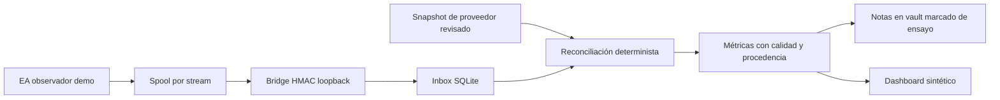

# vidar-mt5-monitor · v0.1.0-dev

Monitor experimental de MT5: eventos, reconciliación periódica, métricas
deterministas y diario de ensayo. **No está listo para producción.**
La gestión de posiciones reales y el motor de ejecución autónoma **no están
validados**. No se incluye un ejecutor de órdenes; el simulador de gestión
siempre devuelve `execution_allowed=false` y `broker_result=NOT_SENT`.

## Arquitectura



Los eventos no sustituyen al historial del broker. Una desaparición sin cierre
acreditado queda `UNKNOWN`. Las clases de calidad son `KNOWN`, `ESTIMATED`,
`UNKNOWN` y `UNVERIFIABLE`; un dato ausente no se convierte en cero.

| Directorio | Contenido |
|---|---|
| `src/original/` | Familia A portable; se conserva separada de B |
| `src/phase_b/` | Transporte, integración sintética, journal y recibos simulados |
| `src/engine/` | Contratos, métricas, supervisor, reportes y simulación offline |
| `src/provider/` | Normalizadores MCP sin transporte y cliente RPyC experimental |
| `src/service/` | CLI, validación de snapshots, outbox, backup y entradas offline |
| `ea/` | Fuentes MQL5 de observadores demo 0.10 y candidato C 0.11 |
| `tests/` | Pruebas y fixtures inventados; no contienen cuentas reales |
| `evidence/publication/` | Resumen saneado de las pruebas de esta publicación |
| `docs/provenance/` | Procedencia y hashes de los archivos seleccionados |

Las familias A y B no son intercambiables. B añade importación como paquete,
control de source/stream y transacciones integradas. El EA C fija explícitamente
login y servidor y bloquea la instancia ante discrepancias.

## Instalación de desarrollo y pruebas

Requisitos: Linux, Python **3.10+** con biblioteca estándar (`sqlite3`, `fcntl`),
`g++` compatible con C++17 para el arnés C, y sockets efímeros de loopback.
Esta publicación se verifica con Python 3.13.5. No se necesita `pip`, MT5, Wine,
RPyC, credenciales ni Internet para ejecutar las pruebas.

```bash
git clone https://github.com/h377ll/vidar-mt5-monitor.git
cd vidar-mt5-monitor
git checkout v0.1.0-dev
resultados_mt5="$(mktemp -d /tmp/vidar-mt5-public-tests-XXXXXX)"
env -i PATH=/usr/bin:/bin LANG=C.UTF-8 python3 -B tools/run_public_checks.py --output-dir "$resultados_mt5/run"
sha256sum -c SHA256SUMS
```

El directorio de resultados debe ser nuevo y externo al repositorio. El ejecutor
lanza los arneses soportados A/B/motor/supervisor/servicios/dashboard/C-host/shadow
y los tests de backfill HTML con entrada sintética. Genera `summary.json`,
logs y resultados fuera del árbol. No usar `unittest discover`: los tests de A
requieren la inyección de fixtures de su ejecutor.

La instalación descrita es solo una copia de desarrollo; no instala servicios.
Para consultar la CLI sin conectarse a un proveedor:

```bash
python3 -B src/service/cli.py --help
```

No se distribuyen configuraciones de cuenta ni unidades/instaladores de despliegue.
La integración viva exige una demo aislada, identidad acreditada, cobertura
comprobada, proveedor revisado, compilación MQL5 y verificación de protecciones.
No ejecutar las CLI de servicio con configuraciones reales a partir de este README.

## Límites y seguridad

- Los ensayos son sintéticos. No validan gestión real, rentabilidad, cumplimiento
  de reglas de una firma, tiempos de entrega ni ejecución autónoma.
- C-host compila cuerpos adaptados a C++ con dobles de MT5: **no es una
  compilación de MetaEditor** ni acredita el binario EX5.
- Los normalizadores MCP no guardan claves ni contactan un endpoint. La proyección
  filtrada conserva cobertura insuficiente como desconocida y no habilita trading.
- El cliente opcional RPyC requiere dependencias externas y un servidor clásico
  que puede ejecutar código remoto. Loopback por sí solo **no lo aísla**; requiere
  un namespace de red separado y revisión de privilegios. No desplegado aquí.
- Las notas de ensayo no sustituyen al diario definitivo. Las métricas no prueban
  cobertura total del broker ni equivalencia con drawdown contractual.
- Outbox: un envío incierto no se reintenta automáticamente; no hay garantía de
  exactly-once remoto. Las guardas Python no son un sandbox del sistema operativo.

Consulta [seguridad](SECURITY.md), [procedencia y derechos](docs/PROVENANCE.md),
[observadores demo](docs/phase-c/OBSERVERS.md) y [validación](docs/VALIDATION.md).

## Derechos y atribuciones

El proyecto de origen no contiene una licencia de código abierto. Esta publicación
autorizada por su propietario **no añade una licencia ni concede permisos de
redistribución nuevos**. Las cabeceras existentes se conservan. Las dependencias
externas no se redistribuyen; véase [THIRD_PARTY.md](THIRD_PARTY.md).
